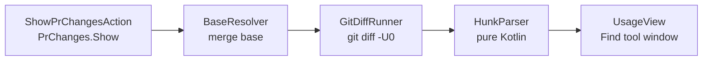

# PR changes navigator: design

## Goal

Walk every hunk of the current branch's PR with the keys already bound to `NextOccurence` and `PreviousOccurence` (`<C-j>`/`<C-k>` in `.ideavimrc`), without unstaging, resetting, or otherwise touching the working tree.

The plugin publishes the hunks to the Find tool window as if they were search results. The Find window already implements the occurrence navigator, so every existing binding works unchanged.

## Decisions

| Question | Choice |
|---|---|
| What a stop shows | The new code only. The editor jumps to the hunk's first line. Removed lines are not shown. |
| Base | Merge base of `HEAD` and an auto-detected default branch, with a per-repo override. |
| Uncommitted edits | Included. The diff runs from the merge base to the working tree, so line numbers match the editor. |
| Refresh | Manual. Running the action again rebuilds the list in the same tab. |
| UI | The existing Find tool window through the Usage View API. No custom tool window. |
| Git access | Git4Idea, which GoLand bundles. |

## Architecture



The action starts a background task. For each git repository root in the project, the task resolves a base, runs the diff, and parses the hunks. It then builds the usages in a read action and shows them on the EDT.

### BaseResolver

Resolves the base ref in this order:

1. `git config prchanges.base`, when set. This is the per-repo override and replaces a settings UI.
2. `origin/main`, when it exists.
3. `origin/master`, when it exists.

It then runs `git merge-base HEAD <ref>` and returns the commit hash together with the ref name, which the tab title uses. It reaches git through a small interface so tests can supply a fake.

### GitDiffRunner

Runs the following in the repository root through Git4Idea and returns stdout:

```sh
git -c core.quotePath=false diff -U0 --inter-hunk-context=0 --no-color --no-ext-diff --no-textconv --src-prefix=a/ --dst-prefix=b/ <merge-base> --
```

Git4Idea adds the `-c core.quotePath=false` itself. The explicit prefixes override a user's `diff.noprefix` or `diff.mnemonicPrefix` config, either of which would otherwise break path parsing. `--inter-hunk-context=0` overrides `diff.interHunkContext`, which would merge nearby hunks and add context lines between them.

Omitting the second revision compares the merge base to the working tree, which includes staged and unstaged edits.

### HunkParser

Pure Kotlin with no platform dependencies. Input is the diff text. The parser counts the `-` and `+` lines each `@@` header promises before it treats any line as a header again. Without that, an added line whose content starts with `++ ` reads as `+++ ...` and is mistaken for a new file path. Output is a list of `FileHunks(path, hunks)`, where each `Hunk` holds a 1-based `startLine` and a `lineCount` taken from the `+c,d` side of the `@@ -a,b +c,d @@` header. An omitted count means 1.

| Case | Behavior |
|---|---|
| Modified file | One `Hunk` per `@@` header. |
| New file (`--- /dev/null`) | Hunks as usual, path from `+++ b/...`. |
| Deleted file (`+++ /dev/null`) | Skipped. There is no new side to jump to. |
| Binary file (`Binary files ... differ`) | Skipped. |
| Rename with edits | Path from `+++ b/...`. |
| Rename without edits | No `@@` headers, so no hunks. |
| Pure deletion (`+c,0`) | `startLine = max(c, 1)`, `lineCount = 0`. The stop lands on the line before the removed lines. |
| Quoted path (`"b/..."`) | Quotes stripped and C escapes decoded. |
| Path containing a space | Git appends a tab to the `+++` line. The tab is stripped. |

### ShowPrChangesAction

Action id `PrChanges.Show`, text "Show PR Changes". For each hunk it resolves the `VirtualFile` from the repository root and the path, gets the `PsiFile` and `Document`, and builds a `UsageInfo` whose range runs from the start of `startLine` to the end of its last line. A hunk with `lineCount = 0` covers its anchor line.

Before it builds the usages, it refreshes the VFS for the changed paths, because a checkout or pull outside the IDE can leave them stale. It builds the usages in a non-blocking read action.

It calls `UsageViewManager.showUsages` with a presentation whose tab text is `PR changes vs <ref> (<short hash>)`. When several repositories resolve to different bases, the title lists the first one and appends a count of the rest. The action opens a new tab and closes the one it opened last time, which it tracks in a project service. It does not use the platform's tab reuse, which would also close the user's unpinned Find Usages tabs.

## Error handling

Each failure shows a balloon notification. Nothing is thrown into the IDE log.

| Situation | Notification |
|---|---|
| No git repository in the project | "No git repository found." |
| No base ref | "No base branch found. Set one with `git config prchanges.base <ref>`." |
| `git merge-base` or `git diff` fails | The git error output. |
| Empty diff | "No changes vs `<ref>` (`<short hash>`)." No tab opens. |
| A hunk's file cannot be resolved to a file and document | The hunk is skipped and the tab title notes how many were skipped. Files in excluded directories still resolve, so their hunks appear. |
| Every hunk was skipped | "N hunks vs `<ref>` (`<short hash>`) could not be resolved to project files." No tab opens. |
| An unexpected exception | "Show PR Changes failed: ..." |

With several repository roots, each is processed on its own. A repository that fails adds a line to one combined notification, and the hunks from the others still appear.

## Known gaps

- Untracked files do not appear, because `git diff <commit>` ignores them.
- Removed lines are never shown. Use the diff viewer when they matter.
- No auto-refresh. Run the action again after a pull or new edits.
- Git4Idea splits output on a bare `\r`, so a content line containing one becomes two lines and can throw off a hunk's line count. The parser resyncs at the next `diff --git` header, so the damage stays within one file.

## Testing

- `HunkParser`: JUnit tests over captured `git diff -U0` output for every row of the parser table.
- `BaseResolver`: JUnit tests with a fake git interface covering the override, `origin/main`, the `origin/master` fallback, and the no-base error.
- Action and Find window: manual checks with `./gradlew runIde` and against a real PR branch. Platform tests for this layer would cost more than the layer itself.

## Build and install

- Kotlin with the IntelliJ Platform Gradle Plugin 2.x.
- Targets GoLand 2026.2 (build 262). Depends on the bundled `Git4Idea` plugin.
- JDK 25, pinned in `mise.toml`. The 2026.2 platform jars are compiled for Java 25 (class file major version 69).
- `./gradlew buildPlugin` produces a zip. Install it with Settings, Plugins, Install Plugin from Disk.
- Bind it in `.ideavimrc`, for example `nmap <leader>gp <Action>(PrChanges.Show)`.
